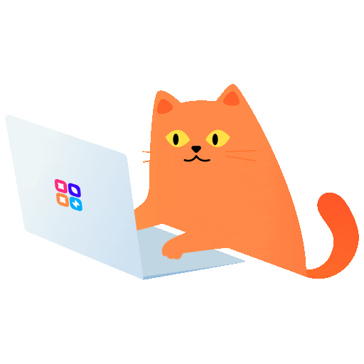

  

<h1 align="center">👋 Hi, I am Eugene Pashkevich!</h1>
<h3 align="center">🧑‍💻 <ins>Frontend</ins> Game developer</h3>

 

<h2 align="center">🦾 My experience:</h2>

  
  
  
  
  

  
  
  
  
  

 

<h3 align="center">📫 How to reach me:</h3>

  
  
  
  

 

---

  <strong>🚀 Just released!</strong>

<h2 align="center">🛠️ FloatTools v1.0.0</h2>

  A floating toolkit for everyday frontend work on your Mac

  

🔄 **PX ↔ REM** conversion with a custom base size  
🎨 **Color picker** with HEX, RGB, RGBA and HSL  
📋 **OCR** to grab text from any screen region  
📏 **Screen ruler** to measure layouts and copy dimensions  
🕘 **Text and color history** with quick copy and delete  
☕ **Donate** to support the project

 

  <strong>macOS 15+ · Apple Silicon & Intel</strong>

